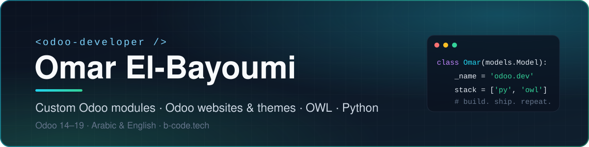

  <a href="https://b-code.tech">🌐 b-code.tech</a> &nbsp;·&nbsp;
  <a href="https://www.linkedin.com/in/omar-albayoumi">💼 LinkedIn</a> &nbsp;·&nbsp;
  <a href="mailto:bayoumiomar@gmail.com">✉️ Email</a>

## About me

I build Odoo solutions that businesses actually run on: custom modules, bilingual Arabic/English websites and themes, and standalone Odoo apps. 4+ years in web development, hands-on with **Odoo 14 to 19**.

- 🏢 Odoo Developer at **Global Solutions** (Odoo Gold Partner), serving clients in Saudi Arabia
- 🧩 Freelance Odoo and web projects through **[B-Code](https://b-code.tech)**
- 🎓 Co-founder of **Aisha Quran Academy**
- 🌍 Remote · Arabic & English

## Tech stack

**Odoo:** ORM · model inheritance · XML views · QWeb reports · access rights · OWL · Odoo Website & themes · Odoo.sh

          

## Featured work

Client and product work delivered through B-Code. Full case studies at **[b-code.tech/work](https://b-code.tech/work)**.

| Project | What it is | Stack |
| --- | --- | --- |
| [Madeeda Hospitals](https://b-code.tech/work/madeeda-hospitals) | Bilingual Odoo website for a 340-bed Saudi hospital group, with native forms for appointments, complaints and job applications | Odoo Website · QWeb · Arabic RTL |
| [Aqar](https://b-code.tech/work/aqar-real-estate) | Real estate app on Odoo: portfolio, brokerage, rentals, customer portal and website listings | Odoo · Python · OWL · QWeb |
| [Horizon Dashboard](https://b-code.tech/work/horizon-dashboard) | 8 live BI dashboards inside Odoo for sales, inventory, finance and POS | Odoo · OWL · Chart.js |
| [Performance Hub](https://b-code.tech/work/performance-hub) | Odoo app that scores developers and consultants from tasks, timesheets and attendance | Odoo · Python · OWL |
| [Arena](https://b-code.tech/work/arena) | Multi-tenant SaaS for gaming lounges: live sessions, POS, bookings and shifts | React · Node.js · PostgreSQL · Socket.IO |
| [ClinoraX](https://b-code.tech/work/clinorax) | Multi-branch clinic management for Windows, web and offline | Electron · React · NestJS · PostgreSQL |

## On GitHub

- **[watad-crm-bridge](https://github.com/OmarBaiomay/watad-crm-bridge)**: Django app that pushes leads into Odoo CRM
- **[oba_hospital](https://github.com/OmarBaiomay/oba_hospital)**: Odoo 15 hospital management module
- **[AishaQuranAcademy](https://github.com/OmarBaiomay/AishaQuranAcademy)**: Aisha Quran Academy platform
- **[NajdSaaS](https://github.com/OmarBaiomay/NajdSaaS)**: SaaS project in TypeScript
- **[react-portfolio](https://github.com/OmarBaiomay/react-portfolio)**: my portfolio site, built with React

## Experience

| Role | Company | Dates |
| --- | --- | --- |
| Odoo Developer | Global Solutions (Odoo Gold Partner) | Jun 2025 – Present |
| Co-Founder | Aisha Quran Academy | Jan 2023 – Present |
| Web Developer | Global Solutions (Odoo Gold Partner) | Jun 2022 – Mar 2024 |
| Frontend Developer | Valinteca | Apr 2022 – Jun 2022 |

---

**Have an Odoo project in mind?** Let's talk → [b-code.tech](https://b-code.tech) · [LinkedIn](https://www.linkedin.com/in/omar-albayoumi)

